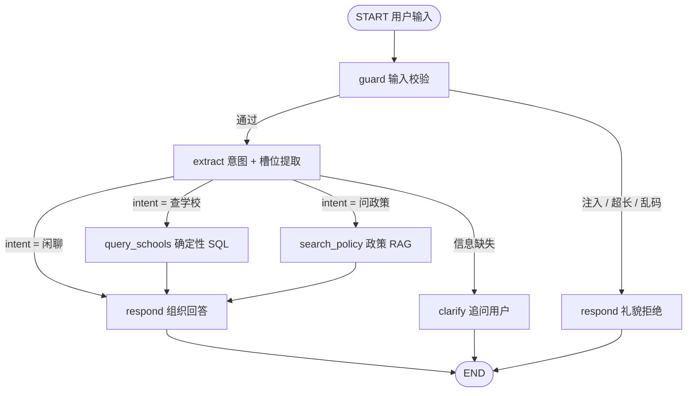

# Phase 1 · 架构设计 — DSE 志愿填报助手（对话版）

> 状态：待确认。确认后进入 Phase 2 编码。
> 配套需求文档：`E:\DSE Connect\Agent升级方案.md`（方案原文，本文档修正其 3 处问题）

---

## 0. C3 判定：真的需要 Agent 吗？

**需要，但是浅层 Agent。**

用判定口诀检验：能不能用 `if/else` 穷举所有分支？

- 用户输入是自然语言，成绩 / 省份 / 专业**可能缺省**，需要多轮追问补全；
- 需要**动态判断**该查学校（SQL）还是问政策（RAG）还是纯闲聊；
- 分支不能事先穷举 → **需要模型参与控制流**。

但它的自主度很低：`提取意图 → 调 1 个工具 → 组织回答`，最多 3 步，**不是**深度自主循环。结论：用 LangGraph 做一个**显式状态机**，而不是完全自由的 ReAct 循环。

---

## 1. 架构模式选择

**选型：Routing（意图路由）+ 工具调用，用 LangGraph 编排成显式状态机。**

| 候选模式 | 为何用 / 不用 |
|---|---|
| 单次 LLM 调用 | ❌ 有外部数据查询，且要动态选工具 |
| Prompt Chaining | ❌ 不是固定线性流水线，有分支 |
| **Routing + 工具调用** | ✅ 意图分发 + 确定性工具，可控可解释 |
| Autonomous Loop（自由 ReAct） | ❌ 自主度超过需求，引入不必要的失控风险 |

**核心原则（沿用项目不变量）**：LLM 只做「聊天 + 意图翻译 + 组织回答」，**确定性查询（筛选 / 排序 / 页码回溯）全部由代码做**。模型绝不生成 SQL。

---

## 2. 架构图



**控制流说明**：

1. 所有输入先过 `guard`（长度上限 + 注入检测 + 乱码过滤），拦截则直接拒绝，不进 LLM。
2. `extract` 是唯一的 LLM 决策节点：输出 `intent`（schools / policy / chitchat）和 `slots`（成绩 / 省份 / 专业词）。
3. `extract` 判断信息缺失 → 走 `clarify` 追问（一次一轮，等用户补充）。
4. 工具节点（`query_schools` / `search_policy`）是**确定性代码**，失败返回结构化错误而非抛异常。
5. 最终统一进 `respond` 组织回答。

**有界性（C5）**：本图天然最多 `extract → 1 工具 → respond` 三步，仍设 `max_steps = 5`、墙钟 120s、单次成本预算兜底。

---

## 3. 组件表

| 组件 | 职责 | 输入 | 输出 | 失败处理 |
|---|---|---|---|---|
| `guard` | 输入校验 | 用户消息 | 通过 / 拦截 | 拦截→礼貌拒绝，不计步不花钱 |
| `extract` | 意图分类 + 槽位提取 | 用户消息 | `intent`, `slots` | LLM 超时→重试 2 次→降级追问；JSON 解析失败→追问 |
| `query_schools` | 确定性 SQL 查询（含繁简转换） | `province`, `scores`, `major` | 院校专业清单 + 页码 | 空结果→`[]`（合法）；DB 错误→`unavailable` |
| `search_policy` | 政策 RAG 检索 | `question` | 政策片段 + 出处 | 检索失败→降级"未使用知识库"并标注 |
| `respond` | 组织自然语言回答 | 工具结果 + 上下文 | 最终回答 | LLM 失败→返回结构化清单兜底 |

---

## 4. 目录结构

```
dse-agent/
├── data/                      # 从 deepseek test 复制 data_all/*.csv + 繁简转换产出
├── app/
│   ├── config.py              # 配置（从 .env 读：DB / LLM / 预算）
│   ├── state.py               # LangGraph State 定义
│   ├── graph.py               # 图编排（guard → extract → tools → respond）
│   ├── llm.py                 # LLM 封装（Qwen / DeepSeek 切换 + 超时 + 重试）
│   ├── budget.py              # 成本护栏（单任务预算）
│   ├── observability.py       # trace_id + 结构化日志 + 指标
│   ├── db.py                  # PostgreSQL 连接 + 建表 + 入库
│   ├── retriever.py           # 政策向量检索
│   ├── tools/
│   │   ├── __init__.py
│   │   ├── query_schools.py   # 确定性 SQL 查询
│   │   └── search_policy.py   # 政策 RAG
│   └── main.py                # 命令行入口（先 CLI，后接 FastAPI）
├── eval/
│   ├── cases.jsonl            # ≥ 20 条评测集
│   └── run_eval.py            # 评测脚本
├── prompts/
│   └── extract/v1.0.0.md      # prompt 版本化
├── scripts/
│   ├── load_data.py           # CSV → PostgreSQL + 繁简转换
│   └── build_index.py         # 政策向量索引
├── tests/                     # 纯函数单测（query_schools）
├── .env.example               # 配置模板（真 .env 不进 Git）
├── requirements.txt
└── README.md
```

---

## 5. 分阶段实施计划（1–2 周业余）

| 阶段 | 内容 | 预估 | 验收标准 |
|---|---|---|---|
| **P1 架构设计** | 本文档 | 今天 | 你确认后进入编码 |
| **P2 环境 + 数据** | PostgreSQL 装库、CSV 入库、繁简转换、`query_schools` 纯函数 + 单测 | 1–2 晚 | 纯函数结果与网页筛选一致 |
| **P3 Agent 竖切片** | LangGraph 图 + `extract` + `query_schools`，命令行跑通 | 2–3 晚 | 命令行人话能查到正确学校 |
| **P4 政策 RAG** | `search_policy` + 向量检索 | 2 晚 | 政策问题能答 + 带出处 |
| **P5 评测 + 可观测** | 20 条评测集 + trace 日志 + 成本护栏 | 2–3 晚 | 评测通过线达标 + 样例 trace |
| **P6 API + 前端**（可选） | FastAPI + SSE + 对话浮窗 | 2–3 晚 | 端到端对话 |

> 顺序按「依赖关系 + 面试价值」排：P2 是地基，P3 是最关键竖切片，P5 是最稀缺加分项。P6 视时间余量决定是否做。

---

## 6. 关键取舍说明

1. **显式路由状态机，而非自由 ReAct 循环**：本项目工具就 2 个、路径就 3 条，显式状态机更可控、可解释、易评测——这三点正是面试要讲的。
2. **`query_schools` 是固定参数函数，不是 Text-to-SQL**：模型只填 `province / scores / major` 三个参数，代码拼固定 SQL。杜绝 SQL 注入与字段幻觉，同时守住"LLM 不计算"不变量。
3. **PostgreSQL + 繁简转换**：母表是繁体（"計算機"），入库统一转简体，否则"计算机"查不到结果。转简在 `load_data.py` 里一次完成。
4. **LLM 可替换 + 可降级**：模型依赖隔离在 `llm.py` 一个模块，Qwen / DeepSeek 一个配置切换；主模型失败自动降级。这是面试可讲的工程点。
5. **评测 + 可观测优先于前端**：多数候选人只有"能跑"，你有"能证明它跑对了"——评测集和 trace 是拉开差距的地方。

---

## 7. 待确认清单

- 模型价格以官方定价页为准：`[待核实: api-docs.deepseek.com / 阿里云百炼控制台]`
- LangChain 的 Qwen / DeepSeek 集成包名与版本：`[待核实: pip 安装时以官方文档为准]`
- PostgreSQL 安装方式（本机安装 vs Docker）：P2 开始时确认
